<div align="center">

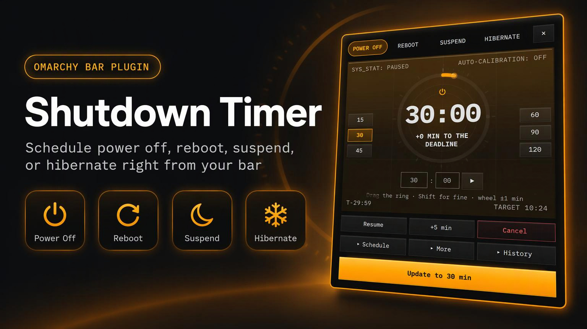

# Shutdown Timer

[English](README.md) · [Русский](README.ru.md) · [简体中文](README.zh.md) · **日本語**

**カウントダウンでシャットダウン、再起動、サスペンド、ハイバネート。いつでも取り消せます。**  
残り時間はバーに出て、最後の三十秒は全画面の警告になり、どの面 —— ポップアップ、
オーバーレイ、通知、CLI —— も同じ言葉で喋ります。

[](https://github.com/valerkaaa/omarchy-shutdown-timer/releases)
[](LICENSE)
[](#インストール)
[](#設定)

[インストール](#インストール) · [スクリーンショット](#スクリーンショット) · [使い方](#使い方) · [設定](#設定) · [仕組み](#仕組み) · [Changelog](CHANGELOG.md)

</div>

---

## 3.0 の新しさ

ポップアップはフォームから道具になりました。

- **ひとつのリング、三通りの操作。** ドラッグすると値は手について動き、押した
  場所へ飛びません（一周で一時間、Shift で微調整）。上でホイールを回すと
  ノッチごとに一分、Shift で五分。二つの入力欄に分と秒を打つこともできます —
  コロンを探す必要はありません。
- **プリセットはリングの周りへ** — 左に 15 / 30 / 45、右に 60 / 90 / 120。
  よく使う時間はワンクリック、中央はきれいなまま。
- **秒は本物です。** `0` + `40` で四十秒のタイマー。デーモンに `set-secs`
  コマンドが増えました。
- **金属のノブ、二色のアーク、分目盛り** — 数字は作りから収まります。
  `11:59:58` はリングを越えず、縮みます。
- **レイアウトは目視ではなく計測**：`tools/acceptance.sh` が、リング・入力欄・
  ヒントが同じ軸にあるか、プリセット列が左右対称か、どのセクションでも溢れて
  いないかを検査します。

## バー

<div align="center">
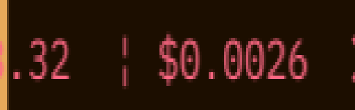
&nbsp;&nbsp;
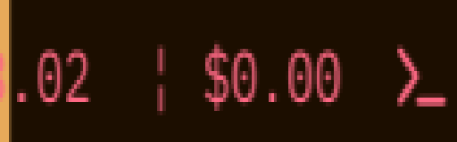
</div>

メニューを開かないと読めないタイマーは、忘れられるタイマーです。これはバーに
住んでいます。電源マークの隣に残り時間、一時停止には一時停止の見た目、最後の
一分には緊急の印 —— 焦点を奪わず、一目で読めます。

- **四つのアクション**：シャットダウン、再起動、サスペンド、ハイバネート。
- **時間の決め方は四通り、どれも速い**：ホイール（ノッチで一分、Shift で
  五分）はポップアップのどこでも、バーのアイコンの上なら開かずに効きます。
  リングの周りに六つのプリセット。リングは相対ドラッグ（一周で一時間、Shift
  で微調整）。そして分と秒の二つの入力欄、コロンは不要（`0` + `40` で
  四十秒）。
- **スケジュール**：曜日ごとの繰り返し（`once` / `daily` / `weekdays` /
  `weekends`）。一覧と削除はポップアップから。
- **条件**：インヒビターの解除（映画、バックアップ）を待ち、低バッテリーを
  見張ります。何を待っているかはポップアップが言います。
- **履歴**：直近の実行と結果（`executed` / `cancelled`）。昨夜の謎が消えます。
- **キーボード優先**：矢印でポップアップを歩き、`Enter` / `Space` で実行、
  `x` で選択中のスケジュール削除、`c` / `p` / `s` / `r` で取消 / 一時停止 /
  延期 / リセット。オーバーレイは `Esc` と `Enter` を直接受けます。
- **言語**：`auto`（システムのロケール）、`en`、`ru` —— 設定ひとつで、
  ポップアップもオーバーレイも通知も CLI も従います。
- **コントラスト検査済み**：ポップアップとオーバーレイの文字は、明暗どちらの
  テーマでも 4.5:1 を自動で満たします。`reducedMotion` は脈動とイージングを
  止めます。

## ポップアップ

<div align="center">
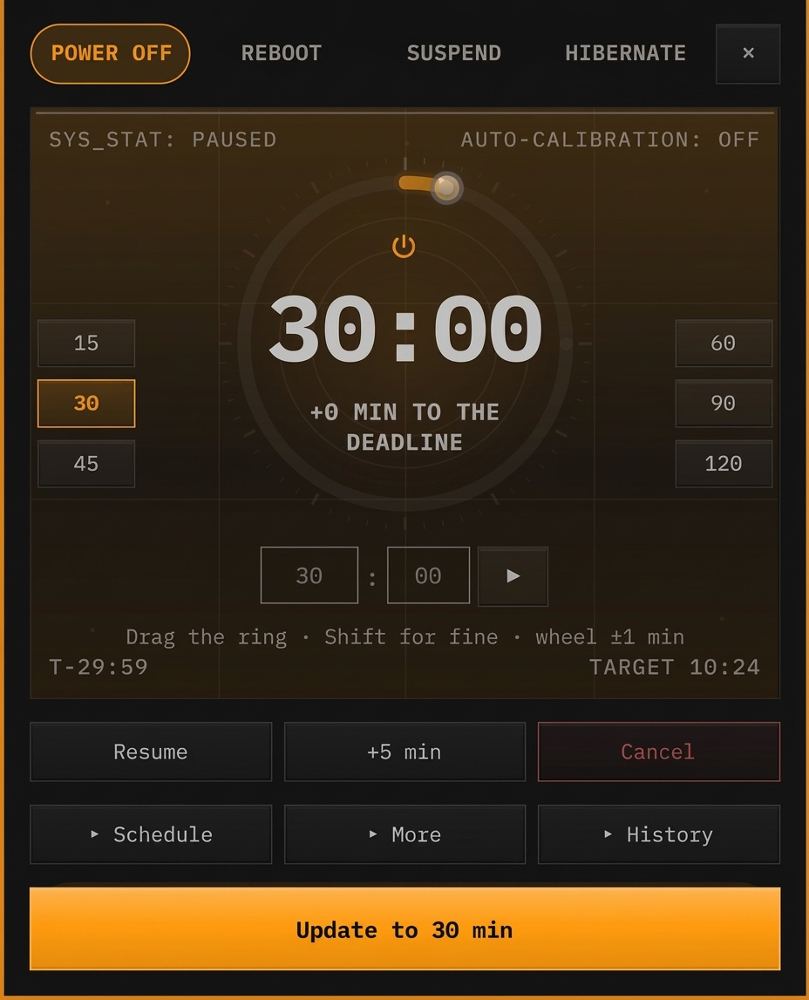
&nbsp;&nbsp;
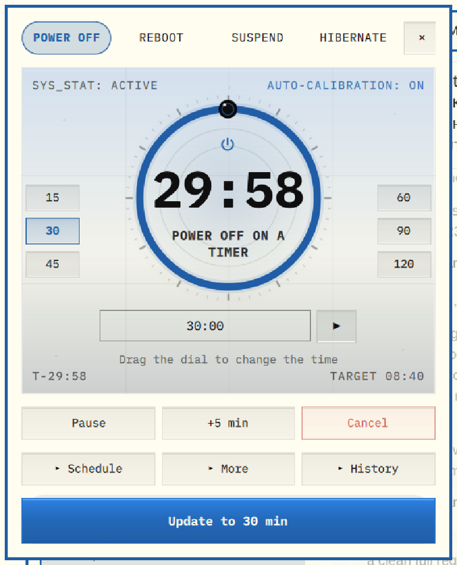
</div>

*左：v3 ポップアップのデザインレンダー。右：Flexoki Light テーマの実物。
実物はすべての色をテーマから取るので、あなたの環境では見た目が違います —
レイアウトは同じです。*

一ページ、上から下へ、タブなし：**アクション**（シャットダウン、再起動、
サスペンド、ハイバネート）、**リング**とその周りの六つのプリセット、分と秒の
**入力欄**、**繰り返し**（一度、毎日、平日、週末）とワンクリックの
スケジュール追加、四つの**ガード**（バッテリーでは動かさない、静かに、ダウン
ロードを待つ、ドライラン）、そして直近の**履歴**。

マークを右クリックすると実行中のタイマーを取り消します。ポップアップの中では
矢印と `Enter` が同じ仕事をします。

## スクリーンショット

四つの状態を動かして（`idle → active → warning → countdown → paused`）：

<div align="center">

</div>

バーの状態。実際のスクリーンショットから切り出したものです — 上が暗いテーマ
（*ristretto*）、下が明るいテーマ（*Flexoki Light*）。どのフレームもウィジェット
自身のスロットで、`tools/screenshots.sh` がバーから切ったもの。手描きは
ありません：

<table>
<tr><th align="left">状態</th><th align="left">暗い</th><th align="left">明るい</th></tr>
<tr><td>待機</td><td>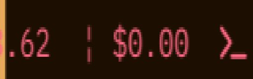</td><td>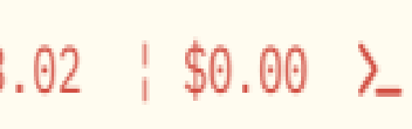</td></tr>
<tr><td>動作中</td><td></td><td>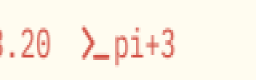</td></tr>
<tr><td>最後の五分</td><td></td><td>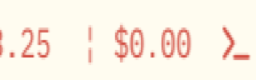</td></tr>
<tr><td>一時停止</td><td>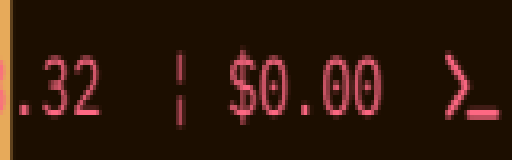</td><td>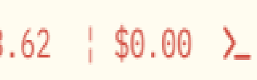</td></tr>
<tr><td>カウントダウン</td><td></td><td>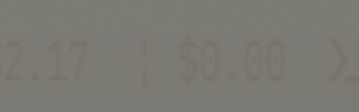</td></tr>
</table>

カウントダウン — 最後の三十秒、すべての上に、テーマ自身のアクセントで：

<div align="center">
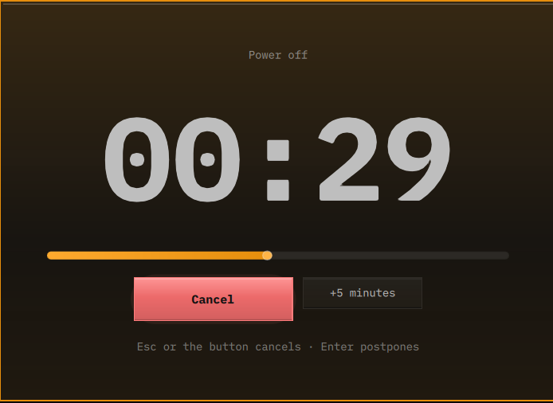
</div>

同じウィジェットを、バーが左に立っているとき：

<div align="center">

</div>

オーバーレイはこのプラグインの値打ちです：**大きな等幅のカウントダウン、
進捗線、Отмена / Cancel と +5 минут / +5 minutes**、`Esc` と `Enter` が
そこに直結しています。layer-shell のサーフェスなので、ウィンドウを動かさずに
現れ、システムのテーマに従います。

実際のバーサイズでのマーク — 16 / 20 / 24 / 32 px、上が暗色、下が明色。
16 px で読めれば、どこでも読めます：

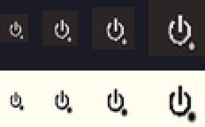

## インストール

```bash
omarchy plugin add https://github.com/valerkaaa/omarchy-shutdown-timer --enable
```

手動でも同じです（フォークの入れ方もこれ）：

```bash
git clone https://github.com/valerkaaa/omarchy-shutdown-timer ~/.config/omarchy/plugins/honor.shutdown-timer
omarchy plugin enable honor.shutdown-timer
```

あとはバーの電源マークをクリック。`~/.config/omarchy/plugins/` に置いただけ
でも動きます。`omarchy plugin validate <dir>` がマニフェストを検査します。

### 更新と削除

```bash
omarchy plugin update honor.shutdown-timer   # 最新リリースを取得
omarchy plugin disable honor.shutdown-timer  # ファイルは残し、ウィジェットを隠す
omarchy plugin remove honor.shutdown-timer   # アンインストール（ファイル + バー項目）
```

削除はプラグインディレクトリとバー項目を片付けます。
`~/.local/state/omarchy/plugins/shutdown-timer/` の状態は意図的に残すので、
入れ直せば履歴が戻ります。完全に消すなら手で削除してください。

### 依存

素の Omarchy 以外は何も要りません：`bash`、`jq` なしのパース、
`systemd-inhibit` と `upower` はあれば使うだけ —— なくてもデーモンは動き
ます。オーバーレイはシェル自身の `qs.Ui` コンポーネントを使います。

## 使い方

マークをクリックしてポップアップを開き、アクションと時間を選んで起動。

- **左クリック** — ポップアップ。**右クリック** — 実行中のタイマーを取り消す、
  待機中なら状態を更新。
- **ポップアップ内**：矢印でカーソル移動、`Enter` で実行、`Esc` で閉じる。
  最初の矢印を押す前の `Enter` はタイマーをすぐ起動します。
- **オーバーレイ内**：`Esc` / キャンセルで取消、`Enter` / +5 で延期。

```bash
cd ~/.config/omarchy/plugins/honor.shutdown-timer
./control.sh set 30 poweroff        # 三十分後
./control.sh at 23:30               # 23:30 に（過ぎていれば明日）
./control.sh status                 # --json で機械可読
./control.sh pause && ./control.sh resume
./control.sh snooze 5
./control.sh cancel
./control.sh schedule add 23:30 daily poweroff
./control.sh schedule list
./control.sh schedule remove <id>
./control.sh history
./control.sh override echo   # ドライラン：記録だけ、マシンは落ちない
./control.sh override off    # 本物のアクションへ戻す
./control.sh override        # 現在のモード
```

| コマンド | すること |
|---|---|
| `set <分> <アクション>` | タイマーを設定、1–1440 分 |
| `at <時:分> [アクション]` | 時刻で設定 |
| `status [--json]` | 状態、アクション、残り |
| `pause` · `resume` | カウントダウンを止めて再開 |
| `snooze <分>` | 実行中のタイマーに分を足す |
| `cancel` · `reset` | タイマーを外す、または外してアクションも消す |
| `schedule add\|list\|remove` | 繰り返しタイマー |
| `history` | 直近の実行と結果 |
| `override echo\|off` | ドライランの切り替え |

## 設定

| キー | 既定 | 意味 |
| --- | --- | --- |
| `language` | `auto` | `auto` はシステムのロケール。`en` / `ru` で固定。 |
| `refreshIntervalSec` | `1` | ポーリング間隔。 |
| `notifyEarlyMins` | `5` | 早めの警告。`0` で無効。 |
| `overlaySeconds` | `30` | 全画面カウントダウンの長さ。 |
| `defaultAction` | `poweroff` | 事前に選ばれるアクション。 |
| `snoozeMins` | `5` | 一度の「延期」/「+N 分」の長さ。 |
| `presets` | `15,30,45,60,90,120` | ポップアップの早見ボタン。 |
| `quiet` | `false` | タイマー設定中は通知を出さない。 |
| `batteryGuard` | `false` | 低バッテリーでは実行しない。 |
| `batteryThreshold` | `20` | 低バッテリーのしきい値、パーセント。 |
| `waitForInhibitors` | `false` | インヒビターが解けるまで待つ。 |
| `reducedMotion` | `false` | 静的なアイコン、進捗のイージングなし。 |

**ドライラン**は設定ではなくファイル（`<state>/action-override`）です。中に
コマンドがある間、デーモンは電源コマンドの代わりに `<コマンド> <アクション>`
を実行します。メニュー（*Advanced → Dry run*）か
`control.sh override echo|off` で切り替え —— 一分のタイマーを、マシンを落とさず
ゼロまで走らせる正直な方法です。

```bash
omarchy bar set honor.shutdown-timer language ru
omarchy bar set honor.shutdown-timer overlaySeconds 60 --json
```

## 仕組み

ひとつのプラグイン、二つの種類（`manifest.json`：`bar-widget` と `overlay`）：

```
Panel.qml      バーのマークとそのポップアップ
Overlay.qml    全画面カウントダウン（PanelWindow + WlrLayershell、IPC honor.shutdown-timer:overlay）
Service.qml    state.json をポーリングし、set/cancel/pause/… と tr() を出す
Model.js       整形と文字列表（STRINGS、t()、resolveLang()）
TimerIcon.qml  電源マーク、ベクター描画
daemon.sh      タイマーの持ち主。state.json を書き、通知を出し、オーバーレイを呼ぶ
control.sh     CLI、そしてデーモンに届かないときのオーバーレイの退路
```

状態は `~/.local/state/omarchy/plugins/shutdown-timer/` に：`state.json`、
`daemon.log`、`daemon.pid`、`control`、`settings.json`、`schedules.tsv`。

デーモンは小さな bash プロセスです。`control.sh ensure` が落ちた後に起こし、
`Service.qml` はいなければ再起動します。`flock` がひとつだけであることを
保証します —— pid ファイルは目安で、真実はロックです。

### 堅牢さ

カウントダウンはデーモンの持ち物なので、玄関に何が来ても生き延びるように
書かれています：

- コマンド経路は**ファイル**で、ソケットではありません。セッションのどの
  プロセスでも書き込めます。だから各コマンドはデーモン自身が検証します
  （`control.sh` だけでなく）：分は 1..1440、アクションは
  `poweroff|reboot|suspend|hibernate|lock` のいずれか、`HH:MM` は範囲内、
  延期回数は正の数、スケジュール id は `[0-9A-Za-z]+` で曜日は 1..7。それ以外
  は記録して無視します —— 以前はデーモンごと、待機中のシャットダウンごと
  殺せました。
- `state.json` は原子的に書きます（`tmp` + `mv`）。読み手が半分のファイルを
  見ることはなく、途中の `kill -9` は前の状態を丸ごと残します。期限切れの
  タイマーは、再起動後に黙って実行せずカウントダウンの窓を開き直します。
- `settings.json`、`state.json`、`schedules.tsv` は毎 tick 読み直すので、
  書きかけや手で編集したファイルでタイマーは壊れません：数値設定は検証して
  文書化した範囲に丸め、状態の各フィールドは安全な既定値に落ち、スケジュール
  ファイルのゴミ行は飛ばします。`tests/test_state_files.sh` が覆っています。
- ネットワークアクセスなし、`eval` なし、`curl | bash` なし。プラグインは
  同梱のファイルと `bash` だけです。

## デバッグ IPC

```bash
omarchy-shell honor.shutdown-timer status          # 状態 + アクション + 残り
omarchy-shell honor.shutdown-timer debugLayout     # バー/ポップアップの幾何数値
omarchy-shell honor.shutdown-timer debugOverflow   # ポップアップから溢れた子
omarchy-shell honor.shutdown-timer:overlay cancel  # オーバーレイのボタンと同じ経路
```

`debugOverflow` はレイアウトがきれいなら `{"count":0,"items":[]}` を返します。
載っているものは本物の溢れで、要素のパスと方向が付きます。

## テスト

```bash
bash tests/run_all.sh              # 全部のテスト、ひとつの判定：SUITE: ALL GREEN
bash tools/acceptance.sh           # 人向けの受け入れリスト
python3 tools/contrast_report.py   # テーマ表面に対する文字のコントラスト、4.5:1
```

スイートは取消の競合、絶対時刻のパース、デーモンの検証、スケジュール、状態
ファイル、スリープと復帰、性能予算を覆います。大半は生きたシェルなしで動く
ので、SSH 越しでも走ります。

## 安全

- 新しいタイマーは常に前のものを上書きします —— 確認ダイアログはありません。
- 電源アクションを実行する経路はすべてクレームファイルを通ります：デーモンが
  自分で `COUNTDOWN` を書き、クレームがまだ新しいときだけ実行するので、同じ
  秒に届いた取消が勝ちます。
- 落とさずに試す：`COUNTDOWN` を待って取り消し、`state.json` が `IDLE` に
  戻ったことを確認する —— あるいはドライラン（*Advanced → Dry run*）を入れて
  タイマーを本当にゼロまで走らせる。
- スリープ中に過ぎた期限は、黒い画面に発砲するのではなく、復帰時に
  カウントダウンの窓を開きます。

## ファイル

```
honor.shutdown-timer/
├── manifest.json    宣言：二つの種類、設定スキーマ（language を含む）
├── Panel.qml        バーのマークとポップアップ
├── Overlay.qml      全画面カウントダウン
├── Service.qml      state.json をポーリングし、set/cancel/pause/…、tr()
├── Model.js         整形と i18n（STRINGS、t()、resolveLang()）
├── TimerIcon.qml    電源マーク（MDI 標準の幾何）
├── daemon.sh        タイマーのデーモン
├── control.sh       CLI
├── assets/          ストア用アイコン、マークの SVG、スクリーンショット
├── tests/           tests/run_all.sh の裏のスイート
└── tools/           開発スクリプト：スクリーンショット、幾何検査、コントラスト報告
```

## ライセンス

MIT —— [LICENSE](LICENSE) を参照。Omarchy とは無関係の、Omarchy 用プラグイン
です。
