<div align="center">

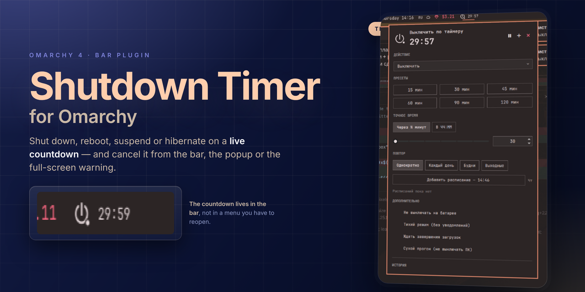

# Shutdown Timer

**Shut down, reboot, suspend or hibernate on a countdown you can always cancel.**  
The remaining time sits in the bar, a full-screen warning takes the last thirty
seconds, and every surface — popup, overlay, notification, CLI — speaks the same
language.

[](https://github.com/valerkaaa/omarchy-shutdown-timer/releases)
[](LICENSE)
[](#install)
[](#settings)

[Install](#install) · [Screenshots](#screenshots) · [Usage](#usage) · [Settings](#settings) · [How it works](#how-it-works) · [Changelog](CHANGELOG.md)

</div>

---

## The bar

<div align="center">
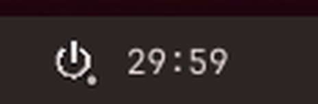
&nbsp;&nbsp;

</div>

A timer you have to reopen a menu to read is a timer you forget. This one lives
in the bar: the remaining time next to the power mark, a paused state that says
so, and an urgent mark in the last minute — readable at a glance, without
stealing focus.

- **Four actions**: power off, reboot, suspend, hibernate.
- **Presets and a slider**: 15 / 30 / 45 / 60 / 90 / 120 minutes in one click,
  anything from 1 to 1440, or an absolute `HH:MM`.
- **Schedule**: repeating timers per weekday (`once` / `daily` / `weekdays` /
  `weekends`), listed and removable from the popup.
- **Conditions**: wait for inhibitors (a film, a backup) and a low-battery guard
  before the action fires; the popup says when it is holding.
- **History**: the last runs with their outcome (`executed` / `cancelled`), so
  last night is not a mystery.
- **Keyboard-first**: arrows walk the popup, `Enter` / `Space` activates, `x`
  removes the selected schedule, `c` / `p` / `s` / `r` cancel / pause / snooze /
  reset. The overlay takes `Esc` and `Enter` directly.
- **Languages**: `auto` (system locale), `en`, `ru` — one setting, followed by
  the popup, the overlay, the notification and the CLI alike.
- **Contrast-checked**: popup and overlay text auto-clears 4.5:1 against the
  theme surface, light and dark alike; `reducedMotion` disables the pulse and
  the easing.

## Screenshots

The four states in motion (`idle → active → warning → countdown → paused`):

<div align="center">

</div>

Bar states, cropped from real screenshots — dark (*ristretto*) on top, light
(*Flexoki Light*) below:

| state | dark | light |
|---|---|---|
| idle (dimmed mark) |  | 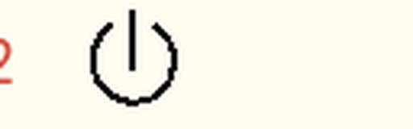 |
| active |  | 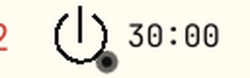 |
| last 5 min (accent) |  | 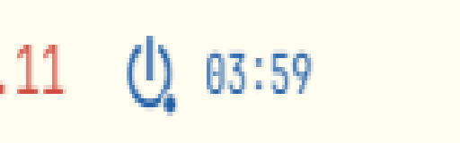 |
| paused | 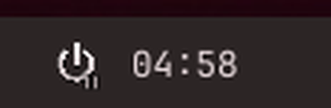 | 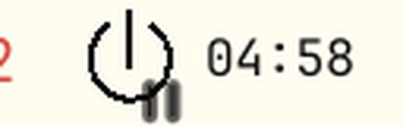 |
| countdown (urgent) |  | 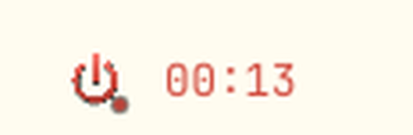 |

The popup, the countdown, and the vertical bar layout:

| popup | countdown overlay | vertical bar |
|---|---|---|
| 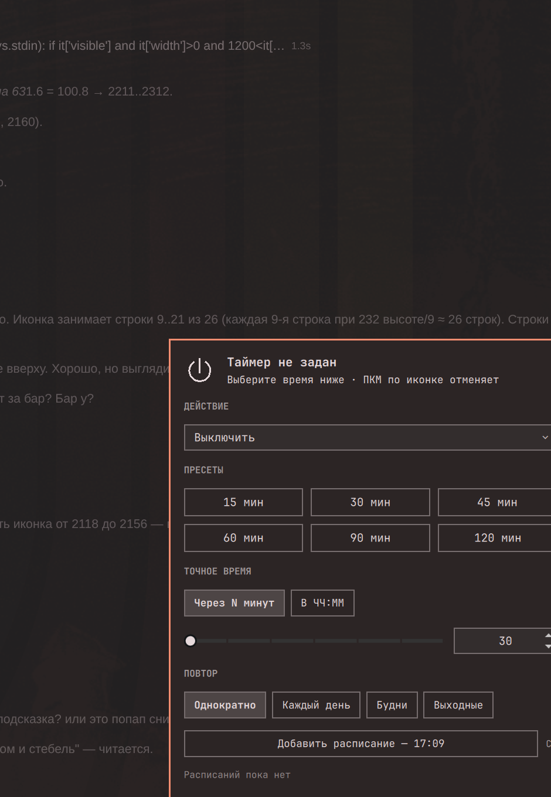 | 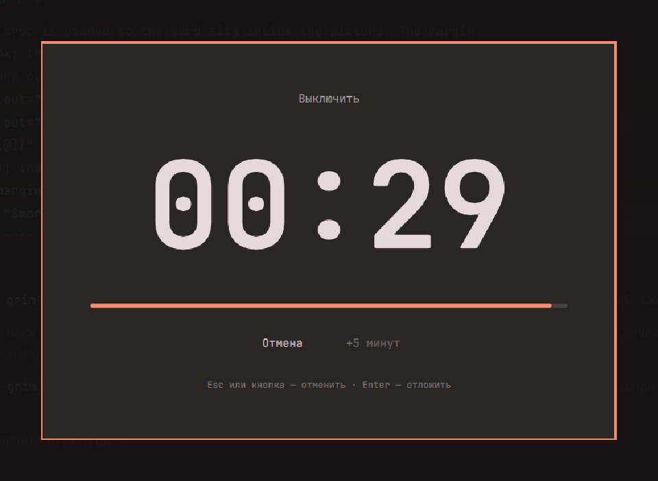 | 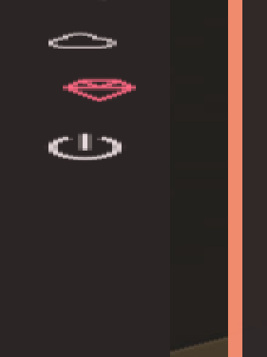 |

The overlay is the part that earns the plugin: **a large monospace countdown, a
progress line, Отмена / Cancel and +5 минут / +5 minutes**, with `Esc` and
`Enter` wired straight to them. It is a layer-shell surface, so it appears
without moving your windows, and it follows the system theme.

The mark at real bar sizes — 16 / 20 / 24 / 32 px, dark on top, light below.
If it reads at 16 px, it reads everywhere:

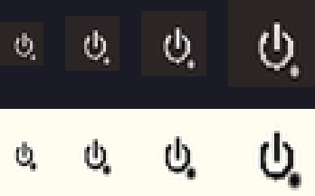

## Install

```bash
omarchy plugin add https://github.com/valerkaaa/omarchy-shutdown-timer --enable
```

Or by hand, which is also how you would install a fork:

```bash
git clone https://github.com/valerkaaa/omarchy-shutdown-timer ~/.config/omarchy/plugins/honor.shutdown-timer
omarchy plugin enable honor.shutdown-timer
```

Then click the power mark in the bar. The plugin also works straight from
`~/.config/omarchy/plugins/`; `omarchy plugin validate <dir>` checks the
manifest.

### Update / remove

```bash
omarchy plugin update honor.shutdown-timer   # pull the latest release
omarchy plugin disable honor.shutdown-timer  # keep the files, hide the widget
omarchy plugin remove honor.shutdown-timer   # uninstall (files + bar entry)
```

Removal cleans the plugin directory and its bar entry; the runtime state under
`~/.local/state/omarchy/plugins/shutdown-timer/` is left behind on purpose, so a
re-install finds its history. Delete it by hand for a full reset.

### Dependencies

Nothing beyond a stock Omarchy: `bash`, `jq`-free parsing, `systemd-inhibit` and
`upower` used opportunistically — the daemon runs without either. The overlay
uses the shell's own `qs.Ui` components.

## Usage

Click the mark to open the popup, pick an action and a time, launch.

- **Left click** — the popup. **Right click** — cancel a running timer, or
  refresh when idle.
- **In the popup**: arrows move the cursor, `Enter` activates, `Esc` closes.
  Before the first arrow press, `Enter` launches the timer straight away.
- **In the overlay**: `Esc` / Отмена cancels, `Enter` / +5 postpones.

```bash
cd ~/.config/omarchy/plugins/honor.shutdown-timer
./control.sh set 30 poweroff        # 30 minutes from now
./control.sh at 23:30               # at 23:30 (tomorrow if already past)
./control.sh status                 # add --json for machine-readable output
./control.sh pause && ./control.sh resume
./control.sh snooze 5
./control.sh cancel
./control.sh schedule add 23:30 daily poweroff
./control.sh schedule list
./control.sh schedule remove <id>
./control.sh history
./control.sh override echo   # dry run: firings are logged, the machine stays on
./control.sh override off    # back to real power actions
./control.sh override        # show the current mode
```

| command | does |
|---|---|
| `set <min> <action>` | arm a timer, 1–1440 minutes |
| `at <HH:MM> [action]` | arm it for a clock time |
| `status [--json]` | state, action, time left |
| `pause` · `resume` | stop and restart the countdown |
| `snooze <min>` | add minutes to a running timer |
| `cancel` · `reset` | drop the timer, or drop it and clear the action |
| `schedule add\|list\|remove` | repeating timers |
| `history` | the last runs and their outcome |
| `override echo\|off` | the dry-run switch |

## Settings

| Key | Default | Meaning |
| --- | --- | --- |
| `language` | `auto` | `auto` follows the system locale; `en` / `ru` force one. |
| `refreshIntervalSec` | `1` | Poll interval. |
| `notifyEarlyMins` | `5` | Early warning; `0` disables it. |
| `overlaySeconds` | `30` | Length of the full-screen countdown. |
| `defaultAction` | `poweroff` | Pre-selected action. |
| `snoozeMins` | `5` | Length of one "snooze" / "+N minutes". |
| `presets` | `15,30,45,60,90,120` | Quick-pick buttons in the popup. |
| `quiet` | `false` | Suppress notifications while a timer is armed. |
| `batteryGuard` | `false` | Do not run the action on low battery. |
| `batteryThreshold` | `20` | Low-battery threshold, percent. |
| `waitForInhibitors` | `false` | Wait until inhibitors clear before firing. |
| `tickSound` | `false` | Tick once per second inside the countdown. |
| `reducedMotion` | `false` | Static icon, no progress-bar easing. |

The **dry run** switch is not a setting but a file (`<state>/action-override`):
while it holds a command, the daemon runs `<command> <action>` instead of the
power command. Toggle it from the menu (*Advanced → Dry run*) or with
`control.sh override echo|off` — the honest way to let a one-minute timer reach
zero without powering the machine off.

```bash
omarchy bar set honor.shutdown-timer language ru
omarchy bar set honor.shutdown-timer overlaySeconds 60 --json
```

## How it works

One plugin, two kinds (`manifest.json`: `bar-widget` and `overlay`):

```
Panel.qml      the bar mark and its popup
Overlay.qml    the full-screen countdown (PanelWindow + WlrLayershell, IPC target honor.shutdown-timer:overlay)
Service.qml    polls state.json, exposes set/cancel/pause/…, and tr()
Model.js       formatting and the string table (STRINGS, t(), resolveLang())
TimerIcon.qml  the power mark, drawn as a vector
daemon.sh      owns the timer, writes state.json, fires the notification, summons the overlay
control.sh     the CLI, and the fallback the overlay uses if the daemon is unreachable
```

State lives in `~/.local/state/omarchy/plugins/shutdown-timer/`: `state.json`,
`daemon.log`, `daemon.pid`, `control`, `settings.json`, `schedules.tsv`.

The daemon is a small bash process. `control.sh ensure` starts it after a crash;
`Service.qml` restarts it if it is not there. A single `flock` guarantees one
daemon — the pid file is only a hint, the lock is the truth.

### Robustness

The daemon owns the countdown, so it is written to survive whatever lands on its
doorstep:

- The command channel is a **file**, not a socket: any process in the session
  can write into it. Every command is therefore validated by the daemon itself
  (not only by `control.sh`): minutes must be 1..1440, the action one of
  `poweroff|reboot|suspend|hibernate|lock`, `HH:MM` in range, the snooze count a
  positive number, and schedule ids `[0-9A-Za-z]+` with weekdays 1..7. Anything
  else is logged and ignored — it used to be able to kill the daemon outright,
  and with it a pending shutdown.
- `state.json` is written atomically (`tmp` + `mv`), so a reader never sees a
  half-written file and a `kill -9` in the middle leaves the previous state
  intact. An overdue timer re-opens the countdown window on restart instead of
  firing silently.
- `settings.json`, `state.json` and `schedules.tsv` are re-read on every tick,
  so a half-written or hand-edited file cannot take the timer down: numeric
  settings are validated and clamped to their documented range, every state
  field falls back to a safe default, and junk lines in the schedule file are
  skipped. Covered by `tests/test_state_files.sh`.
- No network access, no `eval`, no `curl | bash`: the plugin is the files it
  ships plus `bash`.

## Debug IPC

```bash
omarchy-shell honor.shutdown-timer status          # state + action + time left
omarchy-shell honor.shutdown-timer debugLayout     # bar/popup/hero geometry numbers
omarchy-shell honor.shutdown-timer debugOverflow   # children spilling out of the popup
omarchy-shell honor.shutdown-timer:overlay cancel  # same path as the overlay button
```

`debugOverflow` returns `{"count":0,"items":[]}` in every state when the layout
is clean; anything listed there is a real overflow, with the item path and side.

## Tests

```bash
bash tests/run_all.sh              # every test, one verdict: SUITE: ALL GREEN
bash tools/acceptance.sh           # the acceptance list, for a human
python3 tools/contrast_report.py   # text against the theme surface, 4.5:1
```

The suite covers cancellation races, the absolute-time parser, the daemon's
validation, schedules, state files, sleep and resume, and a performance budget.
Most of it runs without a live shell, so it works over SSH.

## Safety

- A new timer always overwrites the previous one — no confirmation dialog.
- Every path that executes a power action goes through the claim file: the
  daemon only runs the action when it wrote `COUNTDOWN` and the claim is still
  fresh, so a cancel that lands in the same second wins.
- To test without powering off: wait for `COUNTDOWN`, then cancel and check
  `state.json` is back at `IDLE` — or flip the dry-run switch (*Advanced → Dry
  run*) and let the timer actually reach zero.
- A deadline that passes while the machine is suspended opens the countdown
  window on wake instead of firing into a black screen.

## Files

```
honor.shutdown-timer/
├── manifest.json    declaration: two kinds, the settings schema (incl. language)
├── Panel.qml        the bar mark and the popup
├── Overlay.qml      the full-screen countdown
├── Service.qml      polls state.json, exposes set/cancel/pause/…, tr()
├── Model.js         formatting and i18n (STRINGS, t(), resolveLang())
├── TimerIcon.qml    the power mark (canonical MDI geometry, bevel copies)
├── daemon.sh        the timer daemon
├── control.sh       the CLI
├── assets/          plugin-store icons, SVG twins of the mark, screenshots
├── tests/           the suite behind tests/run_all.sh
└── tools/           dev scripts: screenshots, geometry checks, contrast report
```

## License

MIT — see [LICENSE](LICENSE). Not affiliated with Omarchy; a plugin for it.
