# Shutdown Timer for Omarchy

Schedule shutdown, reboot, suspend, or hibernate with a live countdown you can
always cancel.

## Features

- **Presets**: 15 / 30 / 45 / 60 / 90 / 120 minutes, one click.
- **Custom time**: slider 1–1440 min plus a numeric field, or an absolute time
  (`ЧЧ:ММ` / `HH:MM`).
- **Four actions**: power off, reboot, suspend, hibernate.
- **Live bar label**: the remaining time sits next to the icon while a timer
  runs; the icon turns urgent in the last minute.
- **Full-screen countdown** (default 30 s, configurable): large monospace
  countdown, a progress bar, **Отмена / Cancel** and **+5 минут / +5 minutes**.
  `Esc` cancels, `Enter` postpones. The overlay follows the system theme.
- **Early warning** (default 5 min): a notification before the action fires.
- **Languages**: `auto` (system locale), `en`, `ru` — switchable per widget in
  the bar settings; the popup, the overlay, the notification and the CLI all
  follow the same setting.
- **Schedule** (TZ 9.5): repeating timers per weekday (`once` / `daily` /
  `weekdays` / `weekends`), listed and removable straight from the popup.
- **Conditions** (TZ 9.4): wait for inhibitors (playing video, backups) and a
  low-battery guard before the action fires; a busy flag is shown in the popup.
- **History** (TZ 6.3): the last runs with their outcome (`executed` /
  `cancelled`), so it is obvious what happened last night.
- **Keyboard-first**: arrow keys walk the popup (actions, presets, repeat,
  schedules, advanced toggles, launch), `Enter`/`Space` activates, `x` removes
  the selected schedule, `c` / `p` / `s` / `r` cancel / pause / snooze / reset.
  The overlay takes `Esc` and `Enter` directly.
- **Contrast-checked**: popup and overlay text auto-clears 4.5:1 against the
  theme surface, on light and dark alike; `reducedMotion` disables the pulse
  and easing.
- **CLI**: `control.sh set 30 poweroff | at 23:30 | cancel | status | pause |
  resume | snooze 5 | reset | schedule add/list/remove | history`.

## Screenshots

The four states in motion (`idle → active → warning → countdown → paused`):


Bar states (dark theme *ristretto* / light theme *Flexoki Light*) — a live
run, cropped from real screenshots:

| state | dark | light |
|---|---|---|
| idle (dimmed icon) |  | 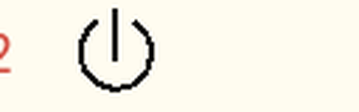 |
| active | 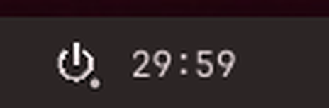 | 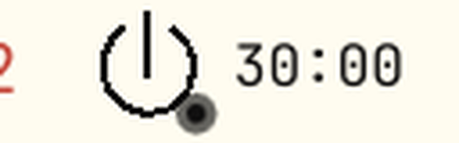 |
| last 5 min (accent) |  | 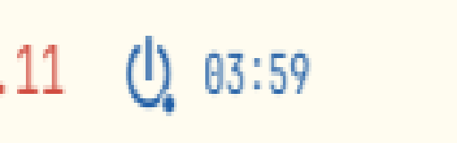 |
| paused | 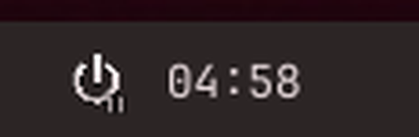 | 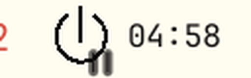 |
| countdown (urgent) |  | 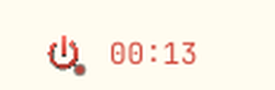 |

The popup, the full-screen countdown, and the vertical bar layout:

| popup | countdown overlay | vertical bar |
|---|---|---|
| 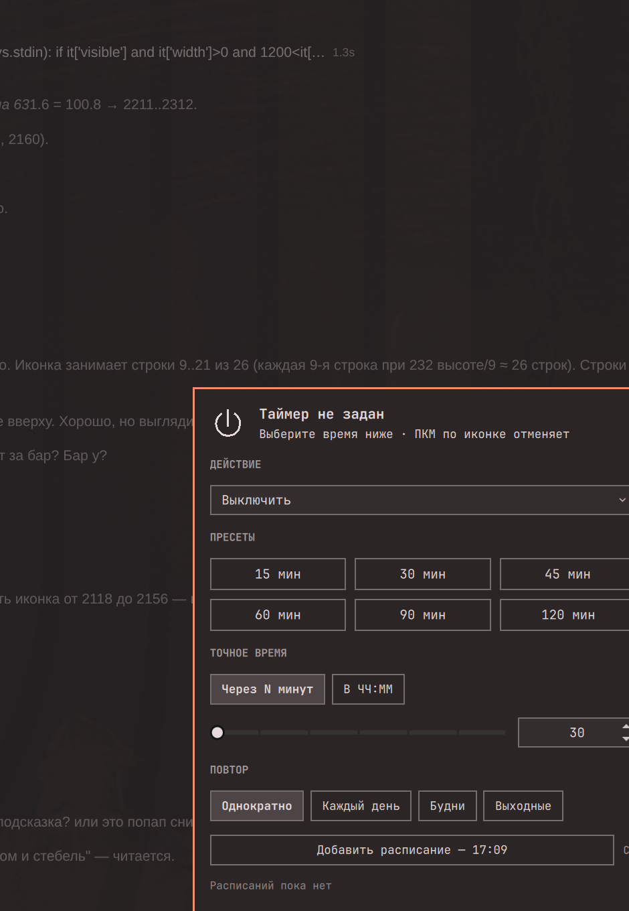 | 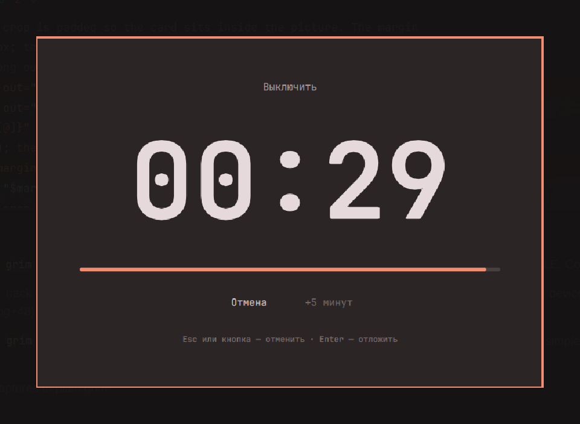 | 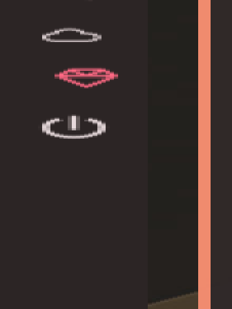 |

The mark at real bar sizes — 16 / 20 / 24 / 32 px, dark on top, light below
(if it reads at 16 px, it reads everywhere):

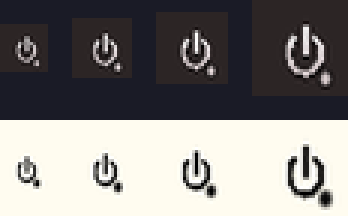

## Architecture

One plugin, two kinds (`manifest.json`: `bar-widget`, `overlay`):

1. **Panel.qml** — the bar button and its popup menu.
2. **Overlay.qml** — the full-screen countdown surface (`PanelWindow` +
   `WlrLayershell`, `IpcHandler` target `honor.shutdown-timer:overlay`).
3. **daemon.sh** — background process that owns the timer, writes `state.json`,
   fires the notification and summons the overlay. Started via `control.sh
   ensure`; restarted automatically by `Service.qml`.
4. **control.sh** — the command-line front end (and the fallback the overlay
   uses if the daemon is unreachable).

State lives in `~/.local/state/omarchy/plugins/shutdown-timer/`
(`state.json`, `daemon.log`, `daemon.pid`, `control`, `settings.json`).

## Files

```
honor.shutdown-timer/
├── manifest.json    # declaration: 2 kinds, settings schema (incl. language)
├── Panel.qml        # bar button + popup menu
├── Overlay.qml      # full-screen countdown overlay
├── Service.qml      # polls state.json, exposes set/cancel/pause/…; tr()
├── Model.js         # formatting + i18n (STRINGS, t(), resolveLang())
├── TimerIcon.qml    # vector power mark (canonical MDI geometry, bevel copies)
├── daemon.sh        # background timer daemon
├── control.sh       # CLI interface
├── assets/          # plugin-store icons + SVG twins of the mark
└── tools/           # local dev scripts (icon preview)
```

## Install

The repository is private, so the plain URL clone needs credentials once:

```bash
gh auth login                                    # if gh is not signed in yet
gh repo clone valerkaaa/omarchy-shutdown-timer ~/.config/omarchy/plugins/honor.shutdown-timer
omarchy plugin enable honor.shutdown-timer
```

With a token in the URL the one-liner works too:

```bash
omarchy plugin add https://<token>@github.com/valerkaaa/omarchy-shutdown-timer
omarchy plugin enable honor.shutdown-timer
```

If the repository is made public later, `omarchy plugin add <url>` alone is
enough and the credentials step can be dropped.

Then click the power mark in the bar. Everything (popup, overlay, CLI,
notifications) follows the widget's `language` setting — `auto` tracks the
system locale.

For local development, the plugin also works straight from
`~/.config/omarchy/plugins/`; `omarchy plugin validate <dir>` checks the
manifest.

### Update / remove

```bash
omarchy plugin update honor.shutdown-timer   # pull the latest release
omarchy plugin disable honor.shutdown-timer  # keep the files, hide the widget
omarchy plugin remove honor.shutdown-timer   # uninstall (files + bar entry)
```

Removal cleans the plugin directory and its bar entry; the runtime state under
`~/.local/state/omarchy/plugins/shutdown-timer/` is left behind on purpose, so
a re-install finds its history. Delete it by hand for a full reset.

### Dependencies

Nothing beyond a stock Omarchy: `bash`, `jq`-free parsing, `systemd-inhibit`
and `upower` are used opportunistically, the daemon runs without either. The
overlay uses the shell's own `qs.Ui` components.

## Usage

Click the bar icon to open the menu, pick an action and a time, then launch.

- **Left click** — open the menu.
- **Right click** — cancel a running timer (or refresh when idle).
- **Esc / Отмена** in the overlay — cancel; **Enter / +5** — postpone.
- **In the menu**: arrows move the cursor, `Enter` activates, `Esc` closes.
  Shortcuts: `c` cancel, `p` pause/resume, `s` snooze, `r` reset, `x` delete
  the selected schedule. Before the first arrow press `Enter` launches the
  timer straight away, so the mouse-free path is: click icon → type `30`? no —
  arrow to a preset → `Enter`.

CLI:

```bash
cd ~/.config/omarchy/plugins/honor.shutdown-timer
./control.sh set 30 poweroff        # 30 minutes from now
./control.sh at 23:30               # at 23:30 (tomorrow if already past)
./control.sh status                 # add --json for machine-readable output
./control.sh pause && ./control.sh resume
./control.sh snooze 5
./control.sh cancel
./control.sh schedule add 23:30 daily poweroff
./control.sh schedule list
./control.sh schedule remove <id>
./control.sh history
./control.sh override echo   # dry run: firings are logged, PC stays on
./control.sh override off    # back to real power actions
./control.sh override        # show the current mode
```

## Settings

| Key | Default | Meaning |
| --- | --- | --- |
| `language` | `auto` | `auto` follows the system locale; `en` / `ru` force one. |
| `refreshIntervalSec` | `1` | Poll interval. |
| `notifyEarlyMins` | `5` | Early warning; `0` disables it. |
| `overlaySeconds` | `30` | Length of the full-screen countdown. |
| `defaultAction` | `poweroff` | Pre-selected action. |
| `snoozeMins` | `5` | Length of one "snooze" / "+N minutes". |
| `presets` | `15,30,45,60,90,120` | Quick-pick buttons in the popup. |
| `quiet` | `false` | Suppress notifications while a timer is armed. |
| `batteryGuard` | `false` | Do not run the action on low battery. |
| `batteryThreshold` | `20` | Low-battery threshold, percent. |
| `waitForInhibitors` | `false` | Wait until inhibitors clear before firing. |
| `tickSound` | `false` | Tick once per second inside the countdown. |
| `reducedMotion` | `false` | Static icon, no progress-bar easing. |

The **dry run** switch is not a setting but a file
(`<state>/action-override`): while it holds a command, the daemon runs
`<command> <action>` instead of the power command. Toggle it from the menu
(*Advanced → Dry run*) or with `control.sh override echo|off`. Handy to let a
1-minute timer actually reach zero without powering the machine off.

```bash
omarchy bar set honor.shutdown-timer language ru
omarchy bar set honor.shutdown-timer overlaySeconds 60 --json
```

## Debug IPC

```bash
omarchy-shell honor.shutdown-timer status          # state + action + time left
omarchy-shell honor.shutdown-timer debugLayout     # bar/popup/hero geometry numbers
omarchy-shell honor.shutdown-timer debugOverflow   # children spilling out of the popup
omarchy-shell honor.shutdown-timer:overlay cancel  # same path as the overlay button
```

`debugOverflow` returns `{"count":0,"items":[]}` in every state when the layout
is clean; anything listed there is a real overflow with the item path and side.

## Safety

- A new timer always overwrites the previous one — no confirmation dialog.
- Every path that executes a power action goes through the claim file: the
  daemon only runs the action when it wrote `COUNTDOWN` and the claim is still
  fresh, so a cancel that lands in the same second wins.
- Tests must cancel before zero: wait for `COUNTDOWN`, then `Esc` / IPC cancel
  and verify `state.json` is back at `IDLE` — or flip the dry-run switch
  (*Advanced → Dry run*) and let the timer actually reach zero.
- A deadline that passes while the machine is suspended opens the countdown
  window on wake instead of firing into a black screen.

## License

MIT
