<div align="center">

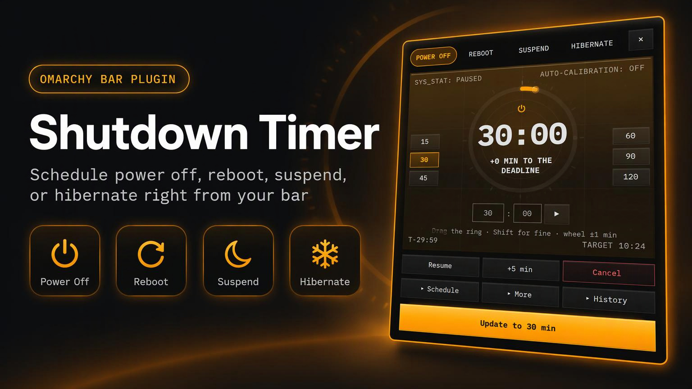

# Shutdown Timer

[English](README.md) · **Русский** · [简体中文](README.zh.md) · [日本語](README.ja.md)

**Выключение, перезагрузка, сон или гибернация по таймеру, который всегда можно отменить.**  
Остаток времени виден в баре, последние тридцать секунд занимает полноэкранное
предупреждение, и все поверхности — попап, оверлей, уведомление, CLI — говорят
на одном языке.

[](https://github.com/valerkaaa/omarchy-shutdown-timer/releases)
[](LICENSE)
[](#установка)
[](#настройки)

[Установка](#установка) · [Скриншоты](#скриншоты) · [Использование](#использование) · [Настройки](#настройки) · [Как устроено](#как-устроено) · [Changelog](CHANGELOG.md)

</div>

---

## Что нового в 3.0

Попап стал инструментом, а не формой.

- **Кольцо, которым можно работать тремя способами.** Тянешь — значение идёт за
  рукой, а не прыгает туда, где нажал (оборот — час, Shift — точный ход);
  крутишь колесо — минута за щелчок, пять с Shift; или вводишь в два поля,
  минуты и секунды, без двоеточия.
- **Пресеты переехали вокруг кольца** — 15 / 30 / 45 слева, 60 / 90 / 120
  справа: частое время в один клик, центр остаётся чистым.
- **Секунды настоящие.** `0` + `40` запускает таймер на сорок секунд; в демоне
  для этого появилась команда `set-secs`.
- **Металлическая головка, двухтоновая дуга, минутная шкала** — и цифра
  вписывается по построению: `11:59:58` сжимается, а не вылезает за кольцо.
- **Вёрстка проверяется, а не «на глаз»**: `tools/acceptance.sh` сверяет, что
  кольцо, поля ввода и подсказка стоят на одной оси, что колонки пресетов
  зеркальны и что ни в одной секции ничего не вылезает.

## Бар

<div align="center">
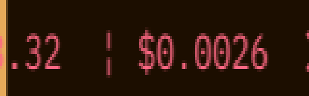
&nbsp;&nbsp;
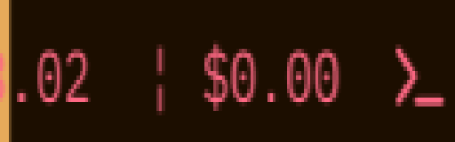
</div>

Таймер, ради которого надо открыть меню, — это таймер, о котором забывают. Этот
живёт в баре: остаток времени рядом со значком питания, отдельное состояние
паузы и тревожная отметка в последнюю минуту — читается взглядом, не забирая
фокус.

- **Четыре действия**: выключение, перезагрузка, сон, гибернация.
- **Четыре способа задать время, и все быстрые**: колесо (щелчок — минута,
  Shift — пять) работает в любом месте попапа и на иконке в баре, даже не
  открывая его; шесть пресетов стоят вокруг кольца; кольцо тянется
  относительно — оборот это час, Shift — точный ход; и два поля принимают
  минуты и секунды без двоеточия (`0` + `40` — сорок секунд).
- **Расписание**: повторяющиеся таймеры по дням недели (`once` / `daily` /
  `weekdays` / `weekends`), список и удаление прямо из попапа.
- **Условия**: дождаться снятия инхибиторов (фильм, бэкап) и защита от низкого
  заряда; попап показывает, чего именно он ждёт.
- **История**: последние срабатывания с исходом (`executed` / `cancelled`), так
  что прошлая ночь перестаёт быть загадкой.
- **Сначала клавиатура**: стрелки ходят по попапу, `Enter` / `Space`
  активируют, `x` удаляет выбранное расписание, `c` / `p` / `s` / `r` —
  отмена / пауза / отложить / сброс. Оверлей принимает `Esc` и `Enter` напрямую.
- **Языки**: `auto` (локаль системы), `en`, `ru` — одна настройка, которой
  следуют попап, оверлей, уведомление и CLI.
- **Контраст проверен**: текст попапа и оверлея автоматически проходит 4.5:1
  относительно поверхности темы, и в тёмной, и в светлой; `reducedMotion`
  отключает пульсацию и сглаживание.

## Попап

<div align="center">
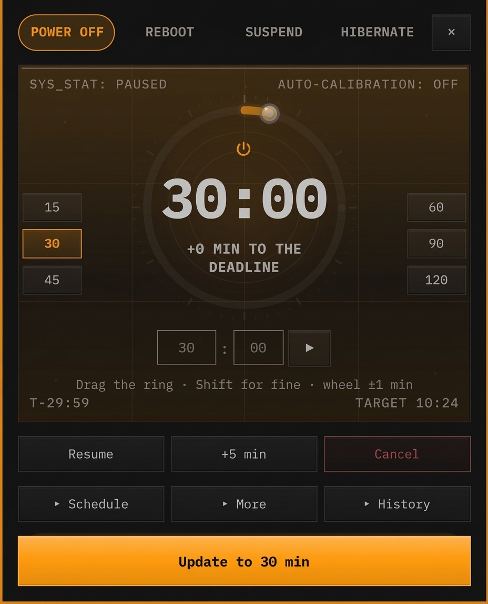
&nbsp;&nbsp;
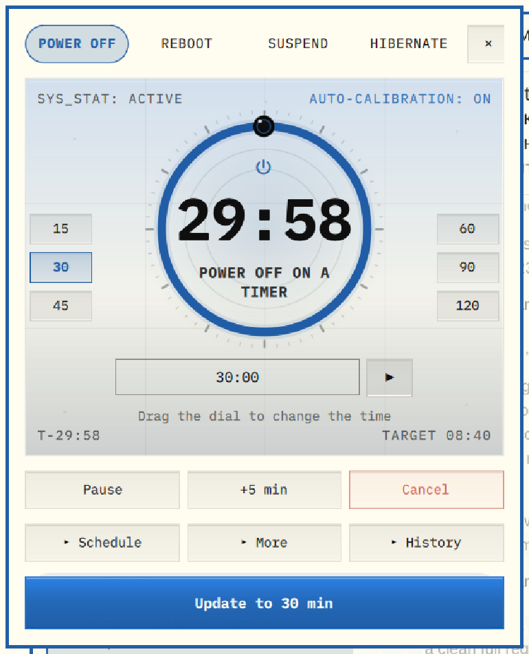
</div>

*Слева — дизайн-рендер попапа v3. Справа — живой попап в теме Flexoki Light.
Живой берёт все цвета из темы, поэтому у тебя он выглядит иначе — раскладка
та же.*

Одна страница сверху вниз, без вкладок: **действие** (выключить, перезагрузить,
усыпить, гибернация), **кольцо** с шестью пресетами вокруг, **поля точного
ввода** для минут и секунд, **повтор** (один раз, ежедневно, по будням, по
выходным) с добавлением расписания в один клик, четыре **предохранителя** (не
действовать от батареи, тихий режим, ждать загрузок, сухой прогон) и
**история** последних запусков.

Правый клик по значку отменяет идущий таймер; внутри попапа то же делают
стрелки и `Enter`.

## Скриншоты

Четыре состояния в движении (`idle → active → warning → countdown → paused`):

<div align="center">

</div>

Состояния бара, вырезанные из реальных скриншотов — тёмная тема (*ristretto*)
сверху, светлая (*Flexoki Light*) снизу. Каждый кадр — слот самого виджета,
вырезанный из бара скриптом `tools/screenshots.sh`; ничего не дорисовано:

<table>
<tr><th align="left">состояние</th><th align="left">тёмная</th><th align="left">светлая</th></tr>
<tr><td>холостой ход</td><td>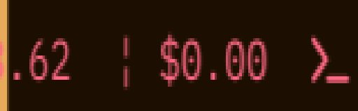</td><td>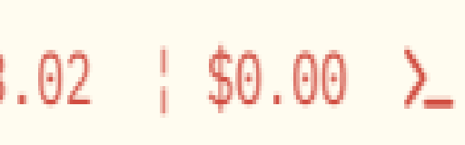</td></tr>
<tr><td>активный</td><td></td><td>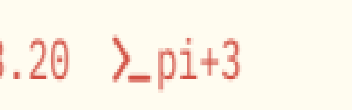</td></tr>
<tr><td>последние 5 мин</td><td></td><td>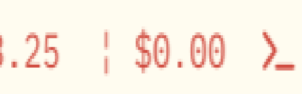</td></tr>
<tr><td>пауза</td><td>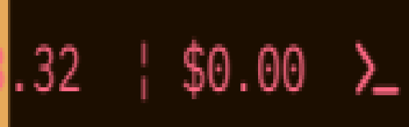</td><td>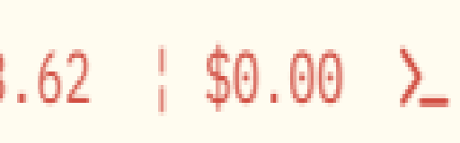</td></tr>
<tr><td>обратный отсчёт</td><td></td><td></td></tr>
</table>

Обратный отсчёт — последние тридцать секунд, поверх всего, в акценте темы:

<div align="center">
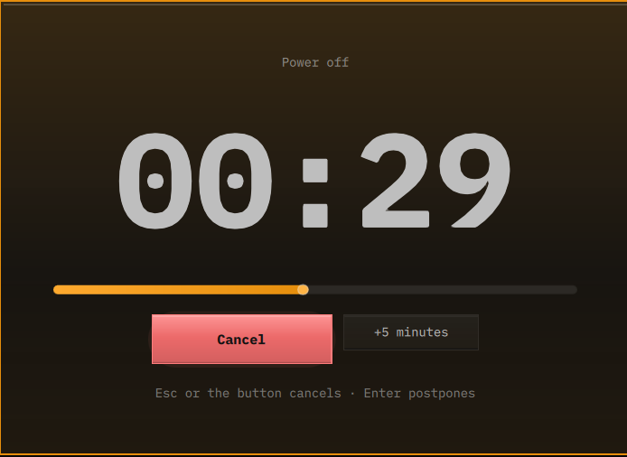
</div>

Тот же виджет, когда бар стоит слева:

<div align="center">

</div>

Оверлей — та часть, ради которой плагин и нужен: **крупный моноширинный
отсчёт, линия прогресса, Отмена / Cancel и +5 минут / +5 minutes**, с `Esc` и
`Enter`, привязанными к ним напрямую. Это layer-shell поверхность: появляется,
не двигая окна, и следует теме системы.

Значок в реальных размерах бара — 16 / 20 / 24 / 32 px, тёмный сверху,
светлый снизу. Если читается в 16 px, читается везде:

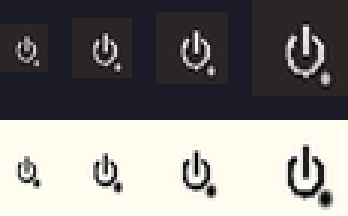

## Установка

```bash
omarchy plugin add https://github.com/valerkaaa/omarchy-shutdown-timer --enable
```

Или руками — так же ставится форк:

```bash
git clone https://github.com/valerkaaa/omarchy-shutdown-timer ~/.config/omarchy/plugins/honor.shutdown-timer
omarchy plugin enable honor.shutdown-timer
```

Дальше — клик по значку питания в баре. Плагин работает и просто из
`~/.config/omarchy/plugins/`; `omarchy plugin validate <dir>` проверяет манифест.

### Обновление и удаление

```bash
omarchy plugin update honor.shutdown-timer   # подтянуть последний релиз
omarchy plugin disable honor.shutdown-timer  # файлы остаются, виджет скрыт
omarchy plugin remove honor.shutdown-timer   # удалить (файлы + запись в баре)
```

Удаление чистит каталог плагина и запись в баре; состояние в
`~/.local/state/omarchy/plugins/shutdown-timer/` остаётся намеренно, чтобы после
переустановки нашлась история. Для полного сброса удали его руками.

### Зависимости

Ничего сверх штатной Omarchy: `bash`, разбор без `jq`, `systemd-inhibit` и
`upower` — по возможности, демон работает и без них. Оверлей использует
компоненты `qs.Ui` самого шелла.

## Использование

Клик по значку открывает попап: выбрать действие, время, запустить.

- **Левый клик** — попап. **Правый** — отменить идущий таймер или обновить
  состояние в простое.
- **В попапе**: стрелки двигают курсор, `Enter` активирует, `Esc` закрывает.
  До первого нажатия стрелок `Enter` запускает таймер сразу.
- **В оверлее**: `Esc` / Отмена отменяет, `Enter` / +5 откладывает.

```bash
cd ~/.config/omarchy/plugins/honor.shutdown-timer
./control.sh set 30 poweroff        # через 30 минут
./control.sh at 23:30               # в 23:30 (завтра, если уже прошло)
./control.sh status                 # с --json — машиночитаемо
./control.sh pause && ./control.sh resume
./control.sh snooze 5
./control.sh cancel
./control.sh schedule add 23:30 daily poweroff
./control.sh schedule list
./control.sh schedule remove <id>
./control.sh history
./control.sh override echo   # сухой прогон: срабатывания в лог, машина жива
./control.sh override off    # обратно к настоящим действиям
./control.sh override        # показать текущий режим
```

| команда | что делает |
|---|---|
| `set <мин> <действие>` | взвести таймер, 1–1440 минут |
| `at <ЧЧ:ММ> [действие]` | взвести на время по часам |
| `status [--json]` | состояние, действие, остаток |
| `pause` · `resume` | остановить и продолжить отсчёт |
| `snooze <мин>` | добавить минут к идущему таймеру |
| `cancel` · `reset` | снять таймер или снять и очистить действие |
| `schedule add\|list\|remove` | повторяющиеся таймеры |
| `history` | последние запуски и их исход |
| `override echo\|off` | переключатель сухого прогона |

## Настройки

| Ключ | По умолчанию | Смысл |
| --- | --- | --- |
| `language` | `auto` | `auto` — локаль системы; `en` / `ru` — принудительно. |
| `refreshIntervalSec` | `1` | Интервал опроса. |
| `notifyEarlyMins` | `5` | Раннее предупреждение; `0` отключает. |
| `overlaySeconds` | `30` | Длина полноэкранного отсчёта. |
| `defaultAction` | `poweroff` | Предвыбранное действие. |
| `snoozeMins` | `5` | Длина одного «отложить» / «+N минут». |
| `presets` | `15,30,45,60,90,120` | Кнопки быстрого выбора в попапе. |
| `quiet` | `false` | Не показывать уведомления, пока таймер взведён. |
| `batteryGuard` | `false` | Не выполнять действие при низком заряде. |
| `batteryThreshold` | `20` | Порог низкого заряда, проценты. |
| `waitForInhibitors` | `false` | Ждать снятия инхибиторов. |
| `reducedMotion` | `false` | Статичная иконка, без сглаживания прогресса. |

**Сухой прогон** — не настройка, а файл (`<state>/action-override`): пока в нём
лежит команда, демон выполняет `<команда> <действие>` вместо команды питания.
Переключается из меню (*Advanced → Dry run*) или через
`control.sh override echo|off` — честный способ дать минутному таймеру дойти до
нуля, не выключая машину.

```bash
omarchy bar set honor.shutdown-timer language ru
omarchy bar set honor.shutdown-timer overlaySeconds 60 --json
```

## Как устроено

Один плагин, два вида (`manifest.json`: `bar-widget` и `overlay`):

```
Panel.qml      значок в баре и его попап
Overlay.qml    полноэкранный отсчёт (PanelWindow + WlrLayershell, IPC honor.shutdown-timer:overlay)
Service.qml    опрашивает state.json, отдаёт set/cancel/pause/…, и tr()
Model.js       форматирование и таблица строк (STRINGS, t(), resolveLang())
TimerIcon.qml  значок питания, нарисованный вектором
daemon.sh      владеет таймером, пишет state.json, шлёт уведомление, поднимает оверлей
control.sh     CLI и запасной путь, которым пользуется оверлей, если демон недоступен
```

Состояние живёт в `~/.local/state/omarchy/plugins/shutdown-timer/`: `state.json`,
`daemon.log`, `daemon.pid`, `control`, `settings.json`, `schedules.tsv`.

Демон — небольшой bash-процесс. `control.sh ensure` поднимает его после падения;
`Service.qml` перезапускает, если его нет. Один `flock` гарантирует
единственность демона — pid-файл только подсказка, правда в блокировке.
Остановка идёт по тому же правилу: `daemon-stop` посылает сигнал тому, кто
держит замок, поэтому номер, оставшийся от убитого демона (и позже занятый
посторонней программой), не будет принят за демона и не получит сигнал.

### Устойчивость

Отсчётом владеет демон, поэтому он написан так, чтобы пережить всё, что
прилетает ему на вход:

- Канал команд — **файл**, не сокет: писать в него может любой процесс сессии.
  Поэтому каждую команду проверяет сам демон (а не только `control.sh`): минуты
  1..1440, действие из `poweroff|reboot|suspend|hibernate|lock`, `ЧЧ:ММ` в
  диапазоне, счётчик отложек — положительное число, id расписаний `[0-9A-Za-z]+`
  с днями 1..7. Всё прочее логируется и игнорируется — раньше это могло убить
  демон вместе с ожидающим выключением.
- `state.json` пишется атомарно (`tmp` + `mv`): читатель никогда не видит
  половину файла, а `kill -9` посреди записи оставляет предыдущее состояние
  целым. Просроченный таймер после перезапуска снова открывает окно отсчёта, а
  не срабатывает молча.
- `settings.json`, `state.json` и `schedules.tsv` перечитываются на каждом тике,
  поэтому полузаписанный или отредактированный руками файл не роняет таймер:
  числовые настройки проверяются и зажимаются в документированный диапазон,
  каждое поле состояния падает в безопасное значение по умолчанию, мусорные
  строки в расписании пропускаются. Покрыто `tests/test_state_files.sh`.
- Никакого доступа в сеть, никакого `eval`, никакого `curl | bash`: плагин — это
  его файлы плюс `bash`.

## Отладочный IPC

```bash
omarchy-shell honor.shutdown-timer status          # состояние + действие + остаток
omarchy-shell honor.shutdown-timer debugLayout     # числа геометрии бара/попапа
omarchy-shell honor.shutdown-timer debugOverflow   # что вылезает за пределы попапа
omarchy-shell honor.shutdown-timer:overlay cancel  # тот же путь, что у кнопки
```

`debugOverflow` возвращает `{"count":0,"items":[]}` в любом состоянии, когда
вёрстка чистая; всё, что там оказалось, — настоящее переполнение, с путём
элемента и стороной.

## Тесты

```bash
bash tests/run_all.sh              # все тесты, один вердикт: SUITE: ALL GREEN
bash tools/acceptance.sh           # список приёмки для человека
python3 tools/contrast_report.py   # текст против поверхности темы, 4.5:1
```

Набор покрывает гонки отмены, разбор абсолютного времени, валидацию в демоне,
расписания, файлы состояния, сон и пробуждение, а также бюджет
производительности. Большая часть работает без живого шелла, поэтому годится и
по SSH.

## Безопасность

- Новый таймер всегда перекрывает предыдущий — без диалога подтверждения.
- Любой путь, выполняющий действие питания, идёт через файл-заявку: демон
  запускает действие только если сам записал `COUNTDOWN` и заявка ещё свежая,
  поэтому отмена, пришедшая в ту же секунду, побеждает.
- Проверить, не выключая машину: дождаться `COUNTDOWN`, отменить и убедиться,
  что `state.json` вернулся в `IDLE` — либо включить сухой прогон
  (*Advanced → Dry run*) и дать таймеру дойти до нуля.
- Дедлайн, прошедший во время сна машины, открывает окно отсчёта при
  пробуждении, а не срабатывает в чёрный экран.

## Файлы

```
honor.shutdown-timer/
├── manifest.json    объявление: два вида, схема настроек (включая language)
├── Panel.qml        значок в баре и попап
├── Overlay.qml      полноэкранный отсчёт
├── Service.qml      опрашивает state.json, отдаёт set/cancel/pause/…, tr()
├── Model.js         форматирование и i18n (STRINGS, t(), resolveLang())
├── TimerIcon.qml    значок питания (каноническая геометрия MDI)
├── daemon.sh        демон таймера
├── control.sh       CLI
├── assets/          иконки для стора, SVG-двойники значка, скриншоты
├── tests/           набор за tests/run_all.sh
└── tools/           дев-скрипты: скриншоты, проверки геометрии, отчёт по контрасту
```

## Лицензия

MIT — см. [LICENSE](LICENSE). Не связан с Omarchy; плагин для него.
