<div align="center">

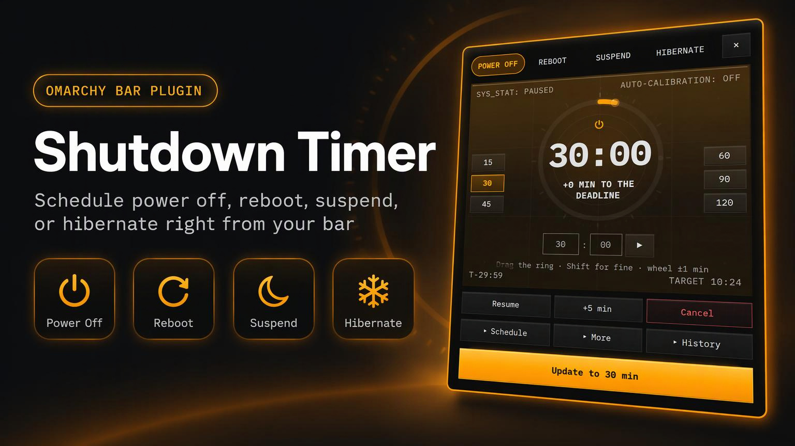

# Shutdown Timer

[English](README.md) · [Русский](README.ru.md) · **简体中文** · [日本語](README.ja.md)

**按倒计时关机、重启、休眠或睡眠，而且随时可以取消。**  
剩余时间就在状态栏里，最后三十秒是全屏提示，所有界面 —— 弹窗、覆盖层、通知、
命令行 —— 说的是同一套语言。

[](https://github.com/valerkaaa/omarchy-shutdown-timer/releases)
[](LICENSE)
[](#安装)
[](#设置)

[安装](#安装) · [截图](#截图) · [使用](#使用) · [设置](#设置) · [工作原理](#工作原理) · [Changelog](CHANGELOG.md)

</div>

---

## 3.0 有什么新东西

弹窗从一张表单变成了一件工具。

- **一个环，三种用法。** 拖动时数值跟着手走，而不是跳到按下的位置（转一圈是
  一小时，按住 Shift 是精调）；在它上面滚动滚轮，一格一分钟，按住 Shift 是
  五分钟；或者往两个输入框里打字，分和秒，不用找冒号。
- **预设挪到了环的两侧** —— 左边 15 / 30 / 45，右边 60 / 90 / 120：常用时间
  一次点击，中间保持干净。
- **秒是真的。** `0` + `40` 就是四十秒的定时器；为此守护进程新增了 `set-secs`
  命令。
- **金属旋钮、双色圆弧、分钟刻度** —— 数字按构造就能放得下：`11:59:58` 会缩小，
  而不是压到环上。
- **排版是被测出来的，不是看出来的**：`tools/acceptance.sh` 检查环、输入框和
  提示是否在同一条轴上，两侧预设列是否对称，以及任何分区里都没有溢出。

## 状态栏

<div align="center">
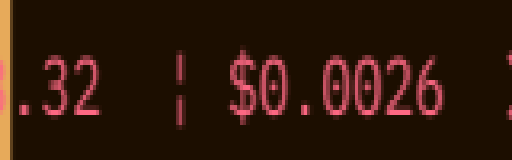
&nbsp;&nbsp;
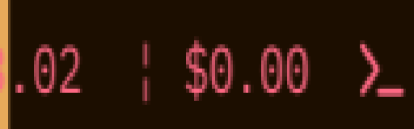
</div>

需要重新打开菜单才能看到的定时器，是会被忘记的定时器。这一个就住在状态栏里：
电源标记旁边是剩余时间，暂停有暂停的样子，最后一分钟有紧急标记 —— 一眼就读
得出来，也不抢焦点。

- **四种动作**：关机、重启、睡眠、休眠。
- **四种设置时间的方式，都快**：滚轮（一格一分钟，Shift 五分钟）在弹窗里任何
  位置都有效，在状态栏图标上甚至不用打开弹窗；环周围有六个预设；环是相对拖动
  —— 一圈一小时，Shift 是精调；还有两个输入框接收分和秒，不用打冒号
  （`0` + `40` 就是四十秒）。
- **计划**：按星期重复（`once` / `daily` / `weekdays` / `weekends`），列表和
  删除都在弹窗里。
- **条件**：等待抑制器解除（看电影、备份），以及低电量保护；弹窗会说明它在等
  什么。
- **历史**：最近几次的结果（`executed` / `cancelled`），昨晚发生了什么不再是谜。
- **键盘优先**：方向键在弹窗里走动，`Enter` / `Space` 激活，`x` 删除选中的
  计划，`c` / `p` / `s` / `r` 分别是取消 / 暂停 / 延后 / 重置。覆盖层直接接收
  `Esc` 和 `Enter`。
- **语言**：`auto`（系统区域）、`en`、`ru` —— 一个设置，弹窗、覆盖层、通知和
  命令行都跟着走。
- **对比度经过检查**：弹窗和覆盖层的文字在明暗两种主题下都自动满足 4.5:1；
  `reducedMotion` 关闭脉冲和缓动。

## 弹窗

<div align="center">
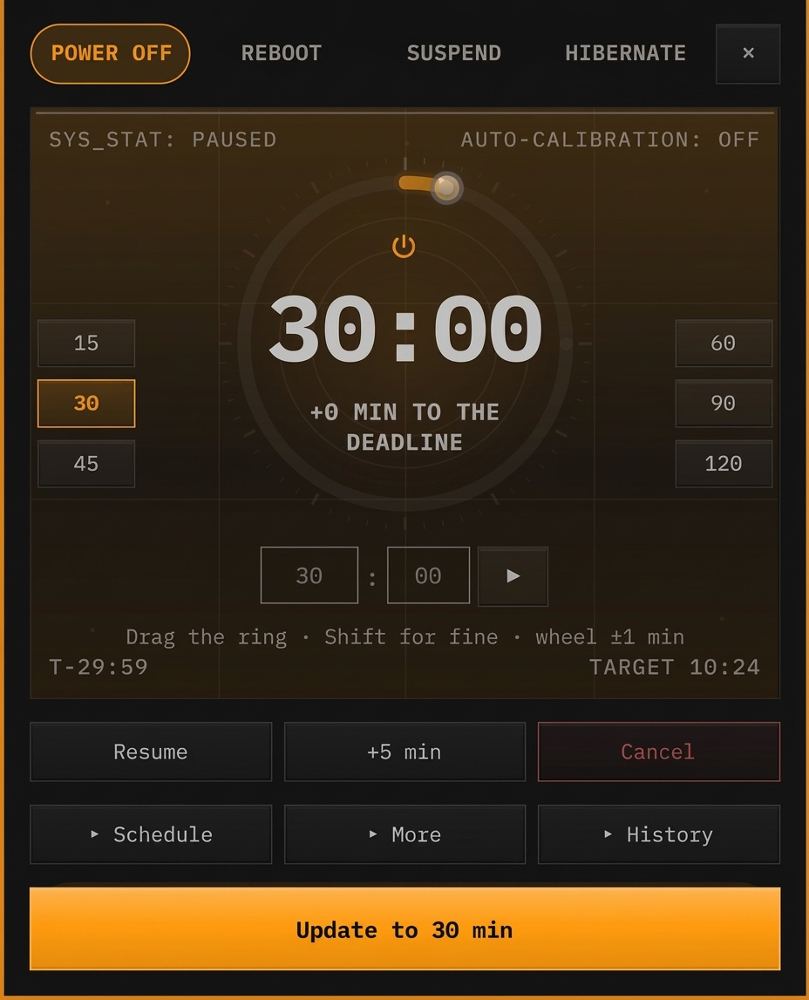
&nbsp;&nbsp;
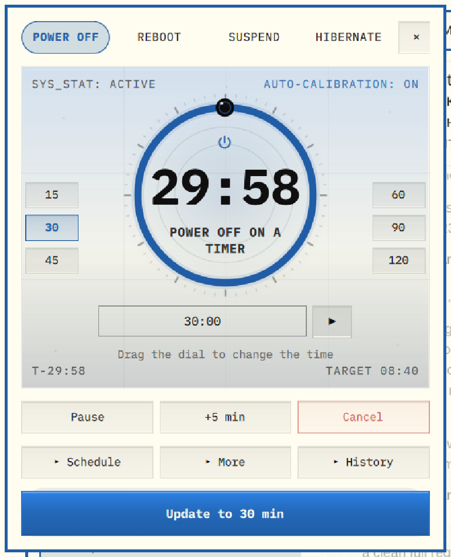
</div>

*左：v3 弹窗的设计稿。右：Flexoki Light 主题下的真实弹窗。真实的那一个所有
颜色都取自主题，所以在你的机器上长得不一样 —— 布局是同一个。*

一页到底，没有标签页：**动作**（关机、重启、睡眠、休眠）、**环**和它周围的
六个预设、**精确输入框**（分和秒）、**重复**（一次、每天、工作日、周末）配
一键添加计划、四个**保护**（低电量不执行、安静、等待下载、空跑）以及最近几次
的**历史**。

右键点图标会取消正在运行的定时器；弹窗里方向键和 `Enter` 做同样的事。

## 截图

四个状态连起来看（`idle → active → warning → countdown → paused`）：

<div align="center">

</div>

状态栏各状态，从真实截图里裁出来的 —— 上面是深色（*ristretto*），下面是浅色
（*Flexoki Light*）。每一帧都是控件自己的位置，由
`tools/screenshots.sh` 从状态栏里切出来，没有一张是手画的：

<table>
<tr><th align="left">状态</th><th align="left">深色</th><th align="left">浅色</th></tr>
<tr><td>空闲</td><td>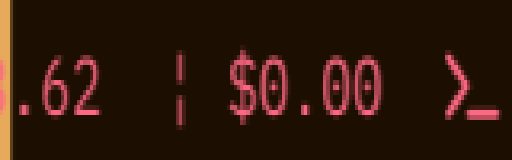</td><td>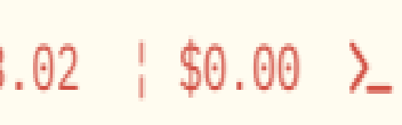</td></tr>
<tr><td>运行中</td><td></td><td>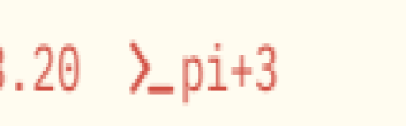</td></tr>
<tr><td>最后 5 分钟</td><td></td><td>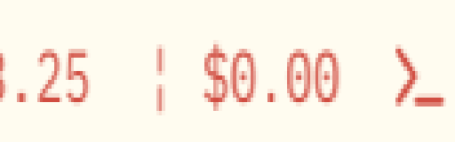</td></tr>
<tr><td>暂停</td><td>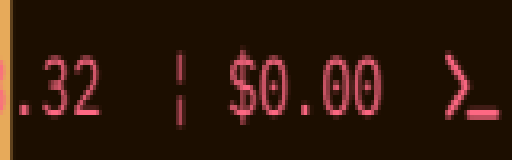</td><td>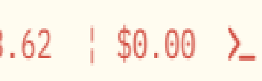</td></tr>
<tr><td>倒计时</td><td></td><td></td></tr>
</table>

倒计时 —— 最后三十秒，盖在所有东西之上，用的是主题自己的强调色：

<div align="center">
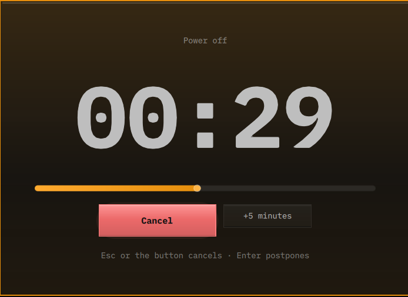
</div>

同一个控件，当状态栏竖着放的时候：

<div align="center">

</div>

覆盖层是这个插件最值钱的部分：**大号等宽倒计时、进度线、取消 / Cancel 和
+5 分钟 / +5 minutes**，`Esc` 和 `Enter` 直接绑在它们身上。它是一个
layer-shell 表面，出现时不推动你的窗口，并跟随系统主题。

图标在真实的状态栏尺寸下 —— 16 / 20 / 24 / 32 px，上面深色，下面浅色。
16 px 能读，哪里都能读：

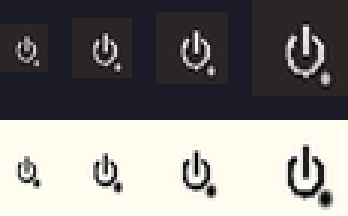

## 安装

```bash
omarchy plugin add https://github.com/valerkaaa/omarchy-shutdown-timer --enable
```

或者手动，安装 fork 也是这个流程：

```bash
git clone https://github.com/valerkaaa/omarchy-shutdown-timer ~/.config/omarchy/plugins/honor.shutdown-timer
omarchy plugin enable honor.shutdown-timer
```

然后点状态栏里的电源标记。插件也可以直接放在 `~/.config/omarchy/plugins/` 下
运行；`omarchy plugin validate <dir>` 会检查清单。

### 更新与删除

```bash
omarchy plugin update honor.shutdown-timer   # 拉取最新发布
omarchy plugin disable honor.shutdown-timer  # 保留文件，隐藏控件
omarchy plugin remove honor.shutdown-timer   # 卸载（文件 + 状态栏条目）
```

卸载会清掉插件目录和状态栏条目；`~/.local/state/omarchy/plugins/shutdown-timer/`
里的运行状态是故意留下的，重装后历史还在。要彻底重置就手动删掉它。

### 依赖

除了一台原装的 Omarchy 什么都不需要：`bash`、不用 `jq` 的解析、
`systemd-inhibit` 和 `upower` 都是能用就用 —— 没有它们守护进程照样跑。覆盖层
用的是 shell 自带的 `qs.Ui` 组件。

## 使用

点图标打开弹窗，选动作和时间，启动。

- **左键** —— 弹窗。**右键** —— 取消正在运行的定时器，空闲时刷新。
- **弹窗里**：方向键移动光标，`Enter` 激活，`Esc` 关闭。在第一次按方向键
  之前，`Enter` 直接启动定时器。
- **覆盖层里**：`Esc` / 取消 取消，`Enter` / +5 延后。

```bash
cd ~/.config/omarchy/plugins/honor.shutdown-timer
./control.sh set 30 poweroff        # 三十分钟后
./control.sh at 23:30               # 23:30（如果已过就是明天）
./control.sh status                 # 加 --json 是机器可读输出
./control.sh pause && ./control.sh resume
./control.sh snooze 5
./control.sh cancel
./control.sh schedule add 23:30 daily poweroff
./control.sh schedule list
./control.sh schedule remove <id>
./control.sh history
./control.sh override echo   # 空跑：只记日志，机器不关
./control.sh override off    # 回到真实动作
./control.sh override        # 查看当前模式
```

| 命令 | 作用 |
|---|---|
| `set <分钟> <动作>` | 设置定时器，1–1440 分钟 |
| `at <时:分> [动作]` | 按时钟时间设置 |
| `status [--json]` | 状态、动作、剩余时间 |
| `pause` · `resume` | 停住和继续倒计时 |
| `snooze <分钟>` | 给正在跑的定时器加时间 |
| `cancel` · `reset` | 取消定时器，或取消并清空动作 |
| `schedule add\|list\|remove` | 重复定时器 |
| `history` | 最近几次运行和结果 |
| `override echo\|off` | 空跑开关 |

## 设置

| 键 | 默认 | 含义 |
| --- | --- | --- |
| `language` | `auto` | `auto` 跟随系统区域；`en` / `ru` 强制指定。 |
| `refreshIntervalSec` | `1` | 轮询间隔。 |
| `notifyEarlyMins` | `5` | 提前提醒；`0` 关闭。 |
| `overlaySeconds` | `30` | 全屏倒计时的长度。 |
| `defaultAction` | `poweroff` | 预选动作。 |
| `snoozeMins` | `5` | 一次「延后」/「+N 分钟」的长度。 |
| `presets` | `15,30,45,60,90,120` | 弹窗里的快捷按钮。 |
| `quiet` | `false` | 定时器已设置时不出通知。 |
| `batteryGuard` | `false` | 低电量时不执行动作。 |
| `batteryThreshold` | `20` | 低电量阈值，百分比。 |
| `waitForInhibitors` | `false` | 等抑制器解除再执行。 |
| `reducedMotion` | `false` | 静态图标，进度条不做缓动。 |

**空跑**不是设置，而是一个文件（`<state>/action-override`）：里面放着命令时，
守护进程执行 `<命令> <动作>` 而不是电源命令。可以从菜单
（*Advanced → Dry run*）或 `control.sh override echo|off` 切换 —— 这是一分钟
定时器走到零又不关机的最诚实办法。

```bash
omarchy bar set honor.shutdown-timer language ru
omarchy bar set honor.shutdown-timer overlaySeconds 60 --json
```

## 工作原理

一个插件，两种类型（`manifest.json`：`bar-widget` 和 `overlay`）：

```
Panel.qml      状态栏标记和它的弹窗
Overlay.qml    全屏倒计时（PanelWindow + WlrLayershell，IPC honor.shutdown-timer:overlay）
Service.qml    轮询 state.json，暴露 set/cancel/pause/…，以及 tr()
Model.js       格式化和字符串表（STRINGS、t()、resolveLang()）
TimerIcon.qml  电源标记，用矢量绘制
daemon.sh      拥有定时器，写 state.json，发通知，唤起覆盖层
control.sh     命令行，以及覆盖层在守护进程不可用时的退路
```

状态放在 `~/.local/state/omarchy/plugins/shutdown-timer/`：`state.json`、
`daemon.log`、`daemon.pid`、`control`、`settings.json`、`schedules.tsv`。

守护进程是一个很小的 bash 进程。`control.sh ensure` 在崩溃后把它拉起来；
`Service.qml` 发现它不在就重启。一个 `flock` 保证只有一个守护进程 ——
pid 文件只是提示，真相在锁里。

### 健壮性

倒计时归守护进程所有，所以它写成了能扛住门口任何东西的样子：

- 命令通道是**文件**，不是套接字：会话里任何进程都能往里写。因此每条命令都由
  守护进程自己校验（不只是 `control.sh`）：分钟必须 1..1440，动作必须是
  `poweroff|reboot|suspend|hibernate|lock` 之一，`HH:MM` 在范围内，延后计数
  是正数，计划 id 是 `[0-9A-Za-z]+` 且星期 1..7。其他一律记日志并忽略 ——
  以前它可以直接把守护进程弄死，连同一次待执行的关机。
- `state.json` 原子写入（`tmp` + `mv`）：读者永远看不到写了一半的文件，
  中途 `kill -9` 也留下完整的上一个状态。过期的定时器在重启后会重新打开倒计时
  窗口，而不是默默执行。
- `settings.json`、`state.json` 和 `schedules.tsv` 每个 tick 都重读，所以
  写了一半或被手改的文件搞不垮定时器：数值设置会被校验并夹到文档范围内，每个
  状态字段都有安全默认值，计划文件里的垃圾行会被跳过。由
  `tests/test_state_files.sh` 覆盖。
- 没有网络访问、没有 `eval`、没有 `curl | bash`：插件就是它带的文件加上
  `bash`。

## 调试 IPC

```bash
omarchy-shell honor.shutdown-timer status          # 状态 + 动作 + 剩余
omarchy-shell honor.shutdown-timer debugLayout     # 状态栏/弹窗的几何数字
omarchy-shell honor.shutdown-timer debugOverflow   # 溢出弹窗的子项
omarchy-shell honor.shutdown-timer:overlay cancel  # 和覆盖层按钮同一条路径
```

`debugOverflow` 在排版干净时返回 `{"count":0,"items":[]}`；里面列出来的都是
真的溢出，带元素路径和方向。

## 测试

```bash
bash tests/run_all.sh              # 全部测试，一个结论：SUITE: ALL GREEN
bash tools/acceptance.sh           # 给人看的验收清单
python3 tools/contrast_report.py   # 文字对主题表面的对比度，4.5:1
```

这套测试覆盖取消竞态、绝对时间解析、守护进程的校验、计划、状态文件、睡眠与
唤醒，以及性能预算。大部分不需要活的 shell，所以走 SSH 也能跑。

## 安全

- 新定时器总是覆盖旧的 —— 没有确认对话框。
- 每条执行电源动作的路径都经过认领文件：只有当守护进程自己写了 `COUNTDOWN` 且
  认领仍然新鲜时才会执行，所以同一秒到达的取消会赢。
- 想试又不关机：等到 `COUNTDOWN`，取消，确认 `state.json` 回到 `IDLE` ——
  或者打开空跑（*Advanced → Dry run*）让定时器真的走到零。
- 机器睡眠期间过期的截止时间，会在唤醒时打开倒计时窗口，而不是对着黑屏执行。

## 文件

```
honor.shutdown-timer/
├── manifest.json    声明：两种类型，设置模式（含 language）
├── Panel.qml        状态栏标记和弹窗
├── Overlay.qml      全屏倒计时
├── Service.qml      轮询 state.json，暴露 set/cancel/pause/…，tr()
├── Model.js         格式化和 i18n（STRINGS、t()、resolveLang()）
├── TimerIcon.qml    电源标记（MDI 标准几何）
├── daemon.sh        定时器守护进程
├── control.sh       命令行
├── assets/          商店图标、标记的 SVG 副本、截图
├── tests/           tests/run_all.sh 背后的测试集
└── tools/           开发脚本：截图、几何检查、对比度报告
```

## 许可

MIT —— 见 [LICENSE](LICENSE)。与 Omarchy 无隶属关系；这是给它的插件。
